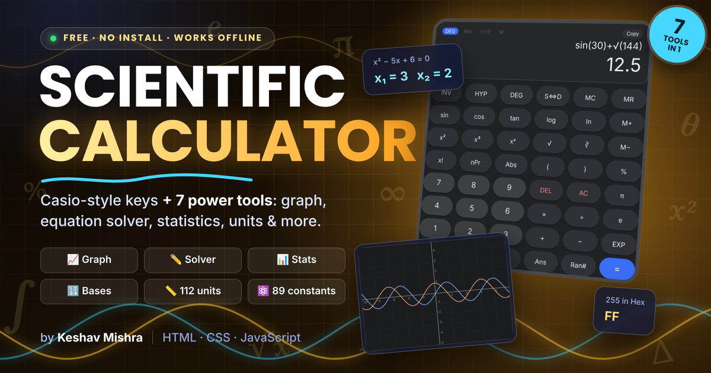
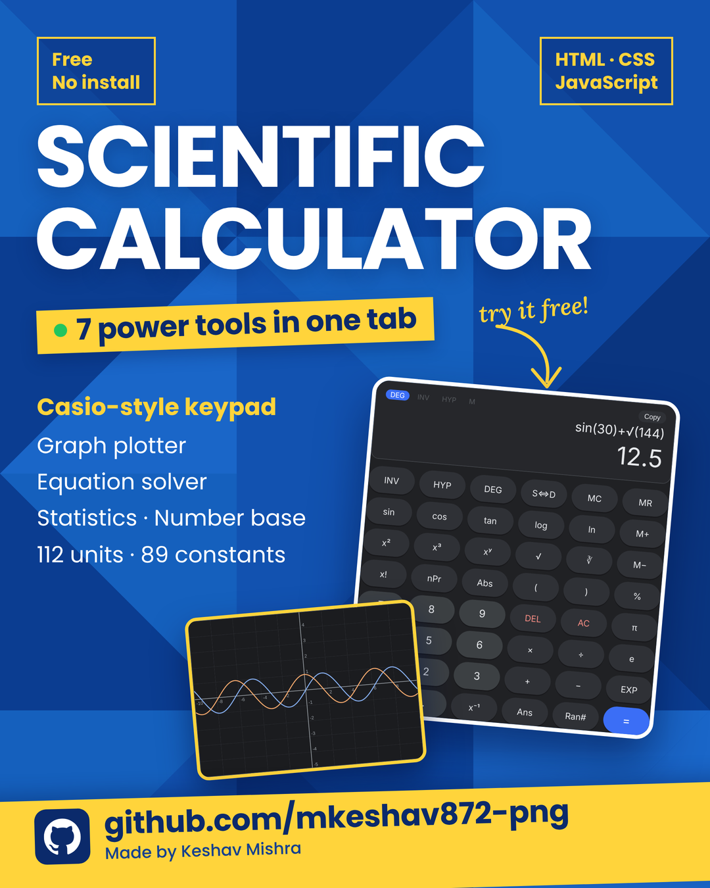

<div align="center">

# 🧮 Scientific Calculator 🧮

### 🔬 A Casio-Style Scientific Calculator + 7 Power Tools, Right in Your Browser ⚡

**Free • Instant • No Install • Works Offline • Phone, Tablet & Desktop**

<br>

<a href="https://mkeshav872-png.github.io/Scientific-Calculator/">
  
</a>

<br><br>

<a href="https://mkeshav872-png.github.io/Scientific-Calculator/">
  
</a>

<br><br>


<br>

[**✨ Features**](#-features) &nbsp;•&nbsp;
[**🧰 Power Tools**](#-the-7-power-tools) &nbsp;•&nbsp;
[**🎓 For Students & Engineers**](#-how-it-helps-students--engineers) &nbsp;•&nbsp;
[**📸 Quick Look**](#-quick-look) &nbsp;•&nbsp;
[**🚀 Run It**](#-run-it-yourself)

</div>

---

## 👋 About the Project

**Scientific Calculator** is a full-featured calculator inspired by the classic **Casio fx-82MS**, rebuilt for the browser. 🎉
Open the link and start calculating. No download, no install, no sign-up.

But it is not just a calculator. Next to the keypad you get a **graph plotter, equation solver, statistics tool, number-base converter, unit converter and a library of science constants**, all in one clean screen. 🧠

> 💡 Everything is written in plain **HTML, CSS and JavaScript**. There are **no libraries, no frameworks and no external requests**. The math engine (tokenizer + BODMAS parser) is written from scratch.

---

## 🎮 Open It Now

| 🌍 App | 👉 Link |
|:---:|:---:|
| **Scientific Calculator** | [**▶ Click Here to Open 🚀**](https://mkeshav872-png.github.io/Scientific-Calculator/) |

> 💡 **Tip:** Works in portrait and landscape on phones, and on tablets and desktops too. You can even type with your keyboard. ⌨️📱💻

---

## ✨ Features

| | Feature | Details |
|:-:|:--|:--|
| 🔢 | **Casio-Style Keypad** | 48 keys: trig, logs, powers, roots, factorial, nPr / nCr, memory, π, e, Ans and more |
| 📐 | **DEG • RAD • GRAD** | One key cycles the angle mode, and a status bar shows which one is active |
| 🔁 | **INV & HYP Keys** | Inverse trig (sin⁻¹…), hyperbolic (sinh…), inverse hyperbolic (sinh⁻¹…), 10ˣ, eˣ and ʸ√x |
| ⚡ | **Live Preview** | A grey answer appears under the screen *while* you type |
| 🧠 | **Smart Parser** | Correct BODMAS, brackets, implicit multiplication like `2π` and `3(4+1)`, and `EXP` for scientific notation |
| 🧮 | **Memory Keys** | `M+`, `M−`, `MR`, `MC` with an **M** indicator, plus `Ans` and `Ran#` |
| 🔀 | **S⇔D Toggle** | Switch an answer between decimal and fraction (`0.75 → 3/4`, `2.5 → 2 1/2`) |
| 🕘 | **History (last 50)** | Saved on your device. Tap any row to bring it back or use its answer |
| ⌨️ | **Full Keyboard Support** | Type directly. `Enter` = equals, `Esc` = clear |
| 🔗 | **Tap-to-Use Results** | Tap any result from any tool to drop it into the calculator |
| 🌙 | **Dark & Light Themes** | One-click switch, and your choice is remembered |
| 🛡️ | **Calculator-Style Errors** | `Math ERROR` and `Syntax ERROR`, e.g. `1÷0`, `tan(90°)`, `asin(2)` |
| 📱 | **Fully Responsive** | Phone, tablet and desktop, with no double-tap zoom on keys |
| 📴 | **Works Offline** | Nothing is loaded from the internet, so it runs from a single file |

---

## 🧰 The 7 Power Tools

The side panel holds seven tools. Every result can be sent back to the calculator with one tap. 👆

| | Tool | What it does |
|:-:|:--|:--|
| 🕘 | **History** | Your last 50 calculations, with *Use answer* buttons and a clear option |
| 📈 | **Graph** | Plot **two functions at once** (f₁ blue, f₂ orange), with quick presets, zoom in/out/reset, custom x/y range and a hover or touch read-out of exact values |
| ✏️ | **Equations** | Quadratic solver (with **complex roots** and the discriminant), **2×2** and **3×3** linear systems |
| 📊 | **Statistics** | Count, sum, mean, median, mode, min, max, range, Σx², Q1, Q3, **population & sample** variance and standard deviation |
| 🔢 | **Number Base** | Binary, Octal, Decimal and Hex at the same time, with input validation |
| 📏 | **Units** | **14 categories** and **112 units**, with a swap button and "same value in every unit" tiles |
| ⚛️ | **Constants** | **89 constants in 8 groups**, searchable, and tap to insert |

<details>
<summary><b>📏 See all 14 unit categories</b></summary>

<br>

| | | | |
|:--|:--|:--|:--|
| 📏 Length | ⚖️ Mass | ⏱️ Time | 🌡️ Temperature |
| ⬛ Area | 🧊 Volume | 🚀 Speed | 🎈 Pressure |
| 🔋 Energy | 💡 Power | 💪 Force | 📐 Angle |
| 📡 Frequency | 💾 Data (KB/KiB, MB/MiB…) | | |

</details>

<details>
<summary><b>⚛️ See all 8 constant groups</b></summary>

<br>

| Group | Examples |
|:--|:--|
| 🧮 **Mathematics** | Golden ratio φ, √2, √3, ln 2, ln 10, Euler–Mascheroni γ |
| 🌌 **Universal physics** | c, h, ħ, G, e, k, Nₐ, R, σ, fine-structure α, Planck units |
| ⚡ **Electricity & magnetism** | ε₀, μ₀, Coulomb constant, Z₀, Faraday, flux quantum, Bohr magneton |
| ⚛️ **Atomic & nuclear** | mₑ, mₚ, mₙ, u, Bohr radius, Rydberg constant, Compton wavelength |
| 🔧 **Mechanics & thermodynamics** | g, atm, specific heats, Young's modulus (steel, Al, Cu), densities, sound speed, refractive indices |
| 🔌 **Electronics & materials** | Thermal voltage V_T, band gaps (Si, Ge), carrier density nᵢ, resistivities (Cu, Al, Ag) |
| 🧪 **Chemistry** | Kw, standard pressure, molar mass constant, R in L·atm |
| 🌍 **Earth, Sun & space** | Earth, Moon and Sun data, escape velocity, AU, light-year, parsec |

</details>

---

## 🎓 How It Helps Students & Engineers

This is built for people who actually have to *calculate things* every day. 💪

### 🧑‍🎓 For School & College Students

- 📚 **Homework and revision:** trig, logs, powers, roots, factorials and permutations and combinations in one place
- ✅ **Check your own work:** the quadratic and linear solvers give instant answers to compare with your steps
- 📈 **See the maths:** plot `sin(x)`, `x²`, `1/x` or `eˣ` and *see* what the equation looks like instead of only memorising it
- 📊 **Statistics made easy:** paste your data, then get the mean, median, mode, quartiles and standard deviation in one click
- 🔄 **No more search tabs:** unit conversions and constants are a tap away, so you don't need to Google "value of G" mid-problem

### 👷 For Engineering Students

| 🎯 Branch / Subject | 🛠️ How the calculator helps |
|:--|:--|
| ⚡ **Electrical & Electronics** | Solve mesh and nodal equations with the **3×3 solver**. Use constants such as ε₀, μ₀, thermal voltage, Si/Ge band gaps and resistivity of Cu, Al and Ag. Convert frequency, power and energy |
| 💻 **Computer Science & Digital Logic** | **Binary ↔ Octal ↔ Decimal ↔ Hex** conversion with grouped binary. Convert bits, bytes, KB vs KiB, MB vs MiB, GB vs GiB |
| ⚙️ **Mechanical & Civil** | Young's modulus, densities and specific heats ready to insert. Convert force (N, kgf, lbf), pressure (Pa, bar, atm, PSI) and area/volume |
| 🔥 **Thermodynamics** | Temperature conversion (°C, °F, K, °R), gas constant R (both forms), latent heats, kcal ↔ kJ ↔ BTU |
| 🧪 **Physics & Chemistry Labs** | Fundamental constants (CODATA 2018 / SI 2019), unit conversion and instant statistics on **lab readings** |
| 🛰️ **Mathematics (Calculus, Algebra)** | Plot two functions together to see intersections. Use hyperbolic and inverse functions, **nPr / nCr** and quadratic roots (including complex ones) |

### 🧪 Example Workflows

1. **Lab report:** paste 10 readings into 📊 Statistics → tap *Sample std. dev.* → it lands in the calculator → finish your error analysis.
2. **Circuit analysis:** enter three KVL equations in ✏️ 3×3 → tap *Tap to use* on each current → plug into the power formula.
3. **Digital electronics:** type `255` in 🔢 Number Base → get `1111 1111`, `377`, `FF` instantly.
4. **Physics problem:** search `planck` in ⚛️ Constants → tap to insert → keep calculating without breaking your flow.

> ⚠️ **Exam note:** This is a study and practice tool. Always check your exam's rules about which calculators are allowed.

---

## 📸 Quick Look

<div align="center">

<a href="https://mkeshav872-png.github.io/Scientific-Calculator/">
  
</a>

*Dark keypad, live graph plotter and seven tools. Open the link above and try it yourself!* 👆

</div>

---

## 🎯 How to Use

1. 👆 Tap the keys, or just **type** with your keyboard. The grey preview shows the answer as you go
2. ⏎ Press **`=`** (or `Enter`) to get the final answer. It is saved to History
3. ➕ Press an operator right after `=` and it **continues from the last answer** (`Ans`)
4. 🔁 Use **INV** or **HYP** *before* a key such as `sin` for sin⁻¹ or sinh. They apply to one key press only
5. 📐 Tap **DEG** to cycle through **DEG → RAD → GRAD**
6. 🧰 Open any tab on the right, calculate there, then **tap a result** to send it to the calculator

<details>
<summary><b>⌨️ Handy examples to try</b></summary>

<br>

| Type this | You get |
|:--|:--|
| `2+3×4` | `14` |
| `sin(30)` *(DEG mode)* | `0.5` |
| `√(144)` | `12` |
| `5!` | `120` |
| `10P3` / `10C3` | `720` / `120` |
| `log(1000)` | `3` |
| `3(4+1)` | `15` |
| `2E3+1` | `2001` |
| `1÷0` | `Math ERROR` |
| `tan(90)` *(DEG mode)* | `Math ERROR` |

</details>

> 📈 **Graph note:** the graph always works in **radians**, so `sin(x)` uses `x` in radians.

---

## ✅ Tested & Reliable

The app was run in a real browser and the keypad and every tool were tested. The tests covered BODMAS, trig in degrees, factorials, permutations and combinations, error handling, the quadratic and 3×3 solvers, number-base conversion, temperature conversion and theme switching. All gave correct answers with **zero JavaScript errors**. 🏆

Tiny floating-point noise is handled like a real calculator: `sin(180°)` shows `0`, not `1.2e-16`, and answers are shown to **10 significant digits**. 🎯

---

## 🧰 Built With

| Technology | Use |
|:-----------|:----|
| 🟧 **HTML5** | App structure and accessible form controls |
| 🟦 **CSS3** | Dark and light themes (CSS variables), responsive grid layout |
| 🟨 **Vanilla JavaScript** | Tokenizer, BODMAS parser, solvers, stats and unit engine (from scratch) |
| 🎨 **Canvas API** | Sharp, retina-ready function graphs |
| 💾 **localStorage** | Remembers history and theme on your device |
| 🌐 **GitHub Pages** | Free hosting |

---

## 📁 Project Structure

```
Scientific-Calculator/
│
├── 📄 index.html                          ← The whole app (single file, no dependencies)
├── 🖼️ Scientific-Calculator-thumbnail.png ← Banner shown at the top of this README
├── 🖼️ Scientific-Calculator-promo.png     ← Promo poster (Quick Look)
├── 📜 LICENSE                             ← All Rights Reserved (view only)
└── 📘 README.md                           ← This file
```

> ✅ The whole app lives in one `index.html`. There is nothing to build and nothing to install.

---

## 🚀 Run It Yourself

```bash
# 1️⃣ Clone the repository
git clone https://github.com/mkeshav872-png/Scientific-Calculator.git

# 2️⃣ Go inside the folder
cd Scientific-Calculator

# 3️⃣ Open index.html in your browser (double-click is enough)
```

> 📴 No internet is needed after you have the file, because nothing loads from a CDN.

---

## 🗺️ Roadmap

- [x] Casio-style keypad with INV, HYP, memory and S⇔D
- [x] Live answer preview and 50-item history
- [x] Graph plotter for two functions
- [x] Quadratic, 2×2 and 3×3 equation solvers
- [x] Statistics, number-base, units (112) and constants (89)
- [x] Dark and light themes, fully responsive
- [ ] 🔜 Complex-number mode
- [ ] 🔜 Matrix calculator
- [ ] 🔜 Installable app (PWA) for full offline use
- [ ] 🔜 Hindi interface 🇮🇳

---

## 🎲 More From Me

<div align="center">

| 🎮 Project | 📝 About | 👉 Open |
|:---:|:---|:---:|
| **Ludo King** | Classic Ludo, 2 to 4 players | [**▶ Play Now**](https://mkeshav872-png.github.io/Lodu-King/) |
| **Chess Queen** | Full chess with a from-scratch engine | [**▶ Play Now**](https://mkeshav872-png.github.io/Chess-Queen/) |
| **Portfolio** | My personal website | [**🌐 Visit**](https://mkeshav872-png.github.io/Portfolio/) |

</div>

---

## 🤝 Let's Connect

Internships, project ideas, feedback or collaboration, I'm open to all of it! 🙌

<div align="center">

[](https://mkeshav872-png.github.io/Portfolio/)
[](https://linkedin.com/in/keshav2k09)
[](https://github.com/mkeshav872-png)
[](https://instagram.com/01nov2k09)

</div>

---

## 📄 License

This project is public for **viewing and learning only**. Copying, editing or republishing it without permission is not allowed. Details: [LICENSE](./LICENSE). 🙏

> ℹ️ This is an independent educational project. It is **inspired by the Casio fx-82MS layout** and is not affiliated with or endorsed by Casio.

---

<div align="center">

### ⭐ Found it useful? Please give this repository a Star! ⭐

**Made with ❤️ and lots of ☕ by [Keshav Mishra](https://github.com/mkeshav872-png)**

*B.Tech CSE Student • Kanpur, India 🇮🇳*

</div>
